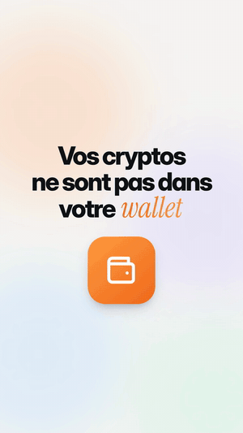
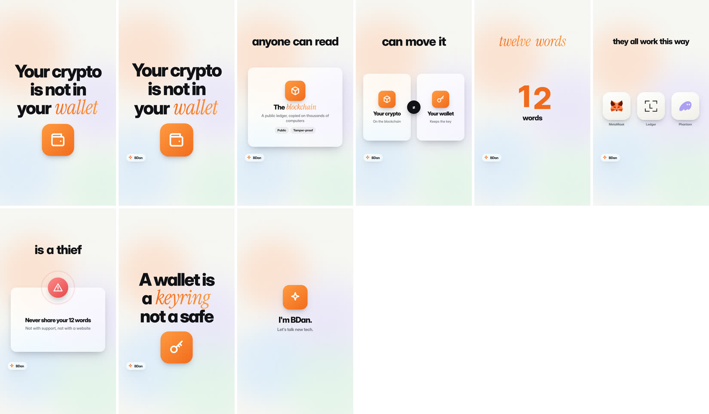

# claude-code-ai-video

**`ai-video`, a Claude Code skill that turns one small JSON file into a vertical short video (TikTok, Reels, YouTube Shorts) in a clean, animated white style.**
You give Claude an idea. Claude:
- writes the script and makes the voice;
- syncs the captions word by word and animates every scene;
- adds music, checks that no text overflows the screen, and renders the MP4.

It takes 2 to 3 minutes per video, and few tokens.

<p align="center">
  
  &nbsp;
  
  &nbsp;
  
</p>

Free and open source (MIT). The default voice is free and needs no API key or subscription. Works in English, French and many other languages.

> Community project, not affiliated with or endorsed by Anthropic. "Claude" and "Claude Code" are trademarks of Anthropic.

---

## What it does

| | |
|---|---|
| **3 modes** | **Fully generated** (neural voice and motion design) · **with images** (your screenshots in a real iPhone or a browser, photos) · **filmed** (captions and animated scenes over your talking-head clip) |
| **16 ready-made scenes** | title, counting number, list, steps, versus, orbiting logos, phone, browser, image, chat, alert, chart, terminal, quote, card, plus a free-form scene |
| **Real logos** | 3,000+ brands ([Simple Icons](https://simpleicons.org)), plus crypto wallets, exchanges, networks and tokens ([web3icons](https://github.com/0xa3k5/web3icons)) |
| **Voices** | hundreds of free neural voices (English, French, Spanish…), your own recording, or a cloned voice |
| **Quality check** | every video is checked (overflowing text, hidden text, errors), then summed up on **one** contact sheet |
| **Sound** | voice at -16 LUFS, music that ducks under the voice, whooshes on transitions, final mix at -14 LUFS (the social-media standard) |
| **Publishing** | cover (frame 1), title, caption, hashtags, pinned comment, plus a guide to posting times and cadence |

<p align="center"></p>

## Why it uses so few tokens

**The usual way.** Making an animated video with an AI usually means having it write 250 to 400 lines of HTML and animation code, then look at dozens of screenshots.

**Here.** Claude writes **one JSON file of 60 to 120 lines**: the sentences, and one scene per idea.
- The bundled script does the rest, and Claude never reads its code.
- To check the result, Claude looks at **one image**: the contact sheet.
- In a blind test, a fresh agent made a finished 60-second video with about 65,000 tokens in total, including reading the skill.

A batch of 10 videos is 10 files and **one** command.

## Install

You need [Claude Code](https://claude.com/claude-code), **Node 18+**, **ffmpeg** and **Python 3**:
- macOS: `brew install node ffmpeg python`;
- Ubuntu: `sudo apt install nodejs ffmpeg python3-venv`.

**Option 1: as a plugin** (easiest)
```
/plugin marketplace add danbaruka/claude-code-ai-video
/plugin install ai-video@ai-video
```

**Option 2: by hand**
```sh
git clone https://github.com/danbaruka/claude-code-ai-video.git
cp -r claude-code-ai-video/skills/ai-video ~/.claude/skills/        # for all your projects
# or: cp -r claude-code-ai-video/skills/ai-video .claude/skills/   # for one project
```

Then, **once**:
```sh
sh ~/.claude/skills/ai-video/scripts/install.sh     # installs the free voice (edge-tts) in its own venv
```
If you forget, Claude runs it by itself before the first video.

## Use it

Just talk to Claude:

> Make a short video about the 3 mistakes that make people lose their crypto.

> Make 5 videos on wallet security, British voice, blue accent.

> Here's my clip `medias/clip.mp4`: add captions and two animated scenes.

> Put these 3 screenshots in a video explaining how to turn on 2FA on Binance.

Claude writes `videos/<id>.json`, builds it, reviews the contact sheet, fixes what needs fixing, then renders the video into `videos/rendus/`.

You can also run the script yourself:
```sh
node ~/.claude/skills/ai-video/scripts/make.mjs videos/my-video.json            # voice + page + check + contact sheet
node ~/.claude/skills/ai-video/scripts/make.mjs videos/*.json --rendu           # a whole batch, as MP4s
```

## A video file

```json
{
  "id": "wallet-key",
  "langue": "en",
  "voix": { "nom": "en-US-AndrewMultilingualNeural" },
  "marque": { "nom": "BDan", "visuel": "icone:etincelle" },
  "phrases": [
    { "texte": "Your crypto is not in your *wallet*.",
      "scene": { "type": "titre", "lignes": ["Your crypto", "is not in", "your *wallet*"], "visuel": "icone:portefeuille" } },
    { "texte": "That key fits in *twelve words*.",
      "scene": { "type": "chiffre", "valeur": "12", "apres": "words", "au": "twelve" } },
    { "texte": "MetaMask, Ledger, Phantom: they all work this way.",
      "scene": { "type": "logos", "marques": ["metamask", "ledger", "phantom"] } }
  ]
}
```

- `*word*` is the strong word: it shows in coloured italics, pulses when spoken, and the camera pushes in on it.
- `au` makes an element appear on a given word.
- The JSON keys are French (`phrases`, `texte`, `scene`…); the spoken text can be in any language.

Three full examples:

| File | Content |
|---|---|
| [`examples/english.json`](skills/ai-video/examples/english.json) | English, fully generated |
| [`examples/generated.json`](skills/ai-video/examples/generated.json) | French, fully generated |
| [`examples/with-images.json`](skills/ai-video/examples/with-images.json) | French, with screenshots, a browser and a chart |

The scene catalog is in [`references/scenes.md`](skills/ai-video/references/scenes.md).

## What's in the repo

```
skills/ai-video/
├── SKILL.md              ← what Claude reads: the workflow, the token-saving rules, the format
├── references/
│   ├── writing.md        ← hooks that work, structure, writing rules
│   ├── scenes.md         ← the 16 scenes, their parameters, icons, layout
│   ├── modes.md          ← voices, screenshots, filmed clips, music
│   └── publishing.md     ← posting times by audience, cadence, captions, the "AI" checkbox
├── scripts/
│   ├── make.mjs          ← json → voice → HyperFrames page → check → contact sheet → MP4
│   ├── voice.py          ← the edge-tts voice, with each word's timing
│   ├── install.sh
│   └── lib/              ← text and captions, scenes, icons, logos, animations
├── assets/               ← the white style (style.css) and its free fonts
└── examples/
```

## Privacy

Everything is built on your machine: the render (HyperFrames and headless Chrome) and the transcription (whisper).

Only these go over the Internet:
- in generated mode, the sentence text, sent to Microsoft's voice service;
- the first download of the tools and logos.

The script turns HyperFrames telemetry off.

## Credits and licences

- This repo's code and style: [MIT licence](LICENSE). © 2026 BDan (Dan Baruka).
- Rendering uses [HyperFrames](https://github.com/heygen-com/hyperframes) (Apache-2.0), fetched by npx.
- Animation uses [GSAP](https://gsap.com) (GSAP standard licence, free), downloaded on first run.
- Fonts: [Inter](https://rsms.me/inter/) and [Instrument Serif](https://fonts.google.com/specimen/Instrument+Serif), under the SIL Open Font License. The files are in `assets/fonts/`.
- Logos: [Simple Icons](https://simpleicons.org) (CC0) and [web3icons](https://github.com/0xa3k5/web3icons) (MIT).
  - Brands belong to their owners. Show them to talk about them, not to suggest a partnership.
- Voice: [edge-tts](https://github.com/rany2/edge-tts) (LGPL-3.0), installed separately by `install.sh`.
