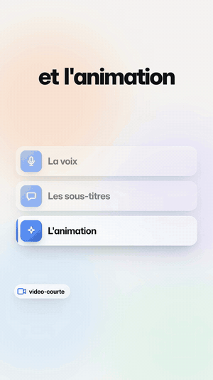
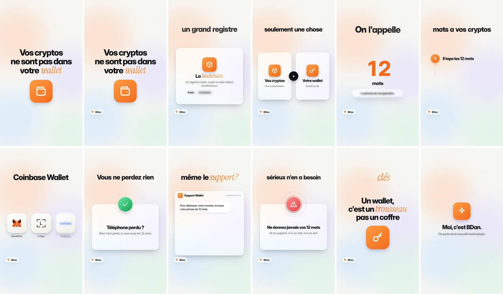

# video-courte

**Des vidéos verticales (TikTok, Reels, Shorts) dans un style blanc net et animé, fabriquées par Claude à partir d'un seul fichier.**
Vous donnez une idée. Claude écrit le texte, fait la voix, cale les sous-titres mot par mot, anime chaque scène, pose la musique, vérifie qu'aucun texte ne déborde de l'écran et rend le MP4. Il faut 2 à 3 minutes par vidéo, et peu de tokens.

<p align="center">
  
  &nbsp;&nbsp;
  
</p>

Gratuit et open source (licence MIT). La voix gratuite par défaut ne demande ni clé ni abonnement.

---

## Ce que ça fait

| | |
|---|---|
| **3 modes** | **Généré à 100 %** (voix de synthèse et motion design) · **avec images** (vos captures dans un vrai iPhone, un navigateur, des photos) · **filmé** (sous-titres et scènes animées sur votre rush) |
| **16 scènes prêtes** | titre, chiffre qui compte, liste, étapes, duel, logos en orbite, téléphone, navigateur, image, conversation, alerte, graphique, terminal, citation, carte, et une scène libre |
| **Les vrais logos** | plus de 3 000 marques ([Simple Icons](https://simpleicons.org)), plus les wallets, exchanges et cryptos ([web3icons](https://github.com/0xa3k5/web3icons)) |
| **Les voix** | 13 voix françaises gratuites (France, Québec, Belgique, Suisse), des centaines dans d'autres langues, ou votre voix enregistrée, ou une voix clonée |
| **Le contrôle** | chaque vidéo est vérifiée (texte qui déborde, texte caché, erreurs), puis résumée sur **une** planche d'aperçu |
| **Le son** | voix à -16 LUFS, musique qui s'efface sous la voix, souffles aux transitions, mixage final à -14 LUFS (la norme des réseaux) |
| **La publication** | couverture (l'image 1), titre, légende, hashtags, commentaire à épingler, et un guide des heures et de la cadence |

<p align="center"></p>

## Pourquoi ça consomme peu de tokens

D'habitude, faire une vidéo animée avec une IA, c'est lui faire écrire 250 à 400 lignes de HTML et d'animation, puis lui faire regarder des dizaines de captures.
Ici, Claude écrit **un fichier JSON de 60 à 120 lignes** : les phrases, et une scène par idée.
Le script fait le reste, sans que Claude relise le code. Pour vérifier, il regarde **une seule image**, la planche.

Un lot de 10 vidéos, c'est 10 fichiers et **une** commande.

## Installer

Il faut [Claude Code](https://claude.com/claude-code), **Node 18+**, **ffmpeg** et **Python 3** :
- macOS : `brew install node ffmpeg python` ;
- Ubuntu : `sudo apt install nodejs ffmpeg python3-venv`.

**Option 1 : en plugin** (le plus simple)
```
/plugin marketplace add danbaruka/video-courte
/plugin install video-courte@video-courte
```

**Option 2 : à la main**
```sh
git clone https://github.com/danbaruka/video-courte.git
cp -r video-courte/skills/video-courte ~/.claude/skills/        # pour tous vos projets
# ou : cp -r video-courte/skills/video-courte .claude/skills/   # pour un seul projet
```

Ensuite, **une seule fois** :
```sh
sh ~/.claude/skills/video-courte/scripts/installer.sh            # installe la voix gratuite (edge-tts) à part
```
Si vous l'oubliez, Claude le lance de lui-même à la première vidéo.

## S'en servir

Parlez à Claude normalement :

> Fais-moi une vidéo courte sur les 3 erreurs qui font perdre des cryptos.

> Fais 5 vidéos sur la sécurité des wallets, voix québécoise, accent bleu.

> Voici mon rush `medias/rush.mp4` : ajoute les sous-titres et deux scènes animées.

> Mets ces 3 captures dans une vidéo qui explique comment activer la 2FA sur Binance.

Claude écrit `videos/<id>.json`, lance la fabrication, relit la planche, corrige, puis rend la vidéo dans `videos/rendus/`.

Vous pouvez aussi lancer le script vous-même :
```sh
node ~/.claude/skills/video-courte/scripts/fabriquer.mjs videos/ma-video.json            # voix + page + contrôle + planche
node ~/.claude/skills/video-courte/scripts/fabriquer.mjs videos/*.json --rendu           # tout un lot, en MP4
```

## Le fichier d'une vidéo

```json
{
  "id": "wallet-cle",
  "voix": { "nom": "fr-FR-RemyMultilingualNeural" },
  "marque": { "nom": "BDan", "visuel": "icone:etincelle" },
  "phrases": [
    { "texte": "Vos cryptos ne sont pas dans votre *wallet*.",
      "scene": { "type": "titre", "lignes": ["Vos cryptos", "ne sont pas dans", "votre *wallet*"], "visuel": "icone:portefeuille" } },
    { "texte": "Cette clé tient en *douze mots*.",
      "scene": { "type": "chiffre", "valeur": "12", "apres": "mots", "au": "douze" } },
    { "texte": "MetaMask, Ledger, Coinbase : tous marchent comme ça.",
      "scene": { "type": "logos", "marques": ["metamask", "ledger", "coinbase"] } }
  ]
}
```

- `*mot*` est le mot fort : il s'affiche en italique de couleur, il bat quand la voix le dit, et la caméra pousse dessus.
- `au` fait arriver un élément sur un mot précis.

Deux exemples complets :
- [`exemples/genere.json`](skills/video-courte/exemples/genere.json) : 100 % généré, crypto ;
- [`exemples/images.json`](skills/video-courte/exemples/images.json) : captures, navigateur, graphique.

Le catalogue des scènes est dans [`references/scenes.md`](skills/video-courte/references/scenes.md).

## Ce que contient le dépôt

```
skills/video-courte/
├── SKILL.md              ← ce que Claude lit : le déroulé, les règles d'économie, le format
├── references/
│   ├── ecrire.md         ← accroches qui marchent, structure, règles d'écriture
│   ├── scenes.md         ← les 16 scènes, leurs paramètres, les icônes, la mise en page
│   ├── modes.md          ← voix, captures, rush filmé, musique
│   └── publier.md        ← heures selon le public, cadence, légende, case « IA »
├── scripts/
│   ├── fabriquer.mjs     ← json → voix → page HyperFrames → contrôle → planche → MP4
│   ├── voix.py           ← la voix edge-tts, avec le temps de chaque mot
│   ├── installer.sh
│   └── lib/              ← texte et sous-titres, scènes, icônes, logos, animations
├── assets/               ← le style blanc (style.css) et ses polices libres
└── exemples/
```

## Vie privée

Tout se fabrique sur votre machine : le rendu (HyperFrames et Chrome sans fenêtre) et la transcription (whisper).
Seuls partent sur Internet :
- le texte des phrases, envoyé au service de voix de Microsoft, en mode généré ;
- le premier téléchargement des outils et des logos.

La télémétrie d'HyperFrames est coupée par le script.

## Crédits et licences

- Le code et le style de ce dépôt sont sous [licence MIT](LICENSE). © 2026 BDan (Dan Baruka).
- Le rendu se fait avec [HyperFrames](https://github.com/heygen-com/hyperframes) (Apache-2.0), téléchargé par npx.
- L'animation utilise [GSAP](https://gsap.com) (licence standard GSAP, gratuite), téléchargé au premier lancement.
- Les polices sont [Inter](https://rsms.me/inter/) et [Instrument Serif](https://fonts.google.com/specimen/Instrument+Serif) (SIL Open Font License, fichiers dans `assets/fonts/`).
- Les logos viennent de [Simple Icons](https://simpleicons.org) (CC0) et de [web3icons](https://github.com/0xa3k5/web3icons) (MIT). Les marques restent à leurs propriétaires : montrez-les pour en parler, pas pour faire croire à un partenariat.
- La voix est faite par [edge-tts](https://github.com/rany2/edge-tts) (LGPL-3.0), installé à part par `installer.sh`.

---

### English

**video-courte** is a Claude Code skill that turns one small JSON file into a vertical short video (TikTok / Reels / Shorts) with a clean white animated style. It covers fully generated videos (free neural voice and motion design), videos with your screenshots or photos, and talking-head videos.
Claude writes the script and the JSON. The bundled script does the voice, word-level captions, 16 animated scene types, real brand logos, music ducking, overflow checks, a one-image contact sheet and the MP4 render.
That keeps token use low. The skill's text is in French. It works in English too: set `"langue": "en"` and pick an `en-US-…` voice.
